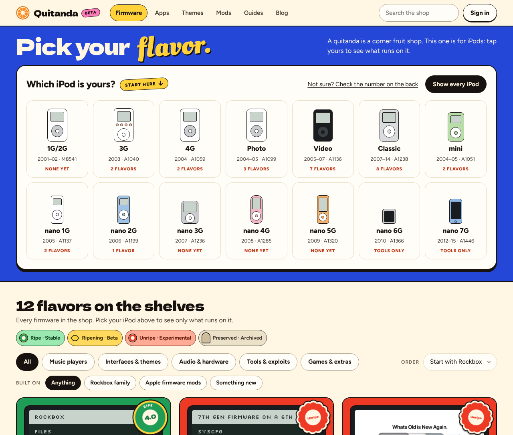

<div align="center">

# 🍊 Quitanda

**Fresh firmware, mods and apps for your iPod.**

[**quitanda.mrbarkan.com**](https://quitanda.mrbarkan.com) · [Suggest a listing](https://github.com/mrbarkan/quitanda/issues/new?template=suggest-listing.yml) · [Report wrong info](https://github.com/mrbarkan/quitanda/issues/new?template=wrong-info.yml) · [Contributing](CONTRIBUTING.md)

 

</div>

Quitanda is a catalog of everything that gives a click-wheel iPod a second life: custom firmware like Rockbox and its forks, the apps that manage an iPod's music, hardware mods that replace what wears out, and themes. Each listing says what it does, which iPods it fits, how to install it and where to get it.

In Portuguese, a quitanda is the small neighborhood shop that sells fruit. The iPod came with one flavor. Here you pick your own.

<p align="center">
  <a href="https://quitanda.mrbarkan.com"></a>
</p>

## What you'll find

- **Pick your iPod and the shop rearranges around it.** Choose your model once and every page shows only what runs on it, with the right download for yours.
- **Firmware, apps, mods and themes** in one place, with a plain "Ripe / Ripening / Unripe / Preserved" status on each.
- **"Does it work on yours?"** Signed-in visitors can report whether a listing worked on their iPod, so the compatibility info gets better with use.
- **Versions that stay fresh.** Anything hosted on GitHub has its latest release, date and stars refreshed every night.

Quitanda links to each project's own downloads. It doesn't host firmware.

## A note on where this stands

Quitanda is in **beta**. The site was built with a lot of help from AI (Claude), and the starting catalog was compiled from each project's public pages, not from hands-on testing. Some details will be wrong or out of date, and some great projects are missing. That's exactly where you come in. The [launch checklist](docs/launch-checklist.md) lists the facts we already know need a second look.

## Help fill the shelves

Most of the catalog will come from the iPod community, and you don't need to know Git to help.

| You want to… | Easiest way |
| --- | --- |
| Suggest a listing or a fix, and get credited | [The suggest form on the site](https://quitanda.mrbarkan.com/suggest/) (sign in with Google) |
| Suggest without signing in | [Suggest a listing](https://github.com/mrbarkan/quitanda/issues/new?template=suggest-listing.yml) |
| Fix a broken link, wrong version or compatibility claim | [Report wrong info](https://github.com/mrbarkan/quitanda/issues/new?template=wrong-info.yml) |
| Share a theme | [The theme form on the site](https://quitanda.mrbarkan.com/themes/submit/) |
| Report something broken on the site | [Report a bug](https://github.com/mrbarkan/quitanda/issues/new?template=bug.yml) |
| Add or edit a listing yourself | Edit [`src/data/catalog.js`](src/data/catalog.js) and open a pull request. [CONTRIBUTING.md](CONTRIBUTING.md) walks through it. |

If you make one of the listed projects and something about it is wrong, the same routes work, and maker corrections go in first. Want a screenshot of your project taken down? Open an issue and it will come down.

## Credit where it's due

Everyone who suggests a listing or a fix gets a card on the site's Contributors page, and a listing you suggested shows "Suggested by" with your Reddit or GitHub handle. Thanks to the r/ipod folks who shaped the first version, and to the makers of every project in the shop. Quitanda only exists because of their work.

## Running it yourself

```bash
npm install
npm run dev
```

The site is static [Astro](https://astro.build), deployed to GitHub Pages, with Firebase for sign-in and shared data. [docs/DEVELOPING.md](docs/DEVELOPING.md) covers the layout of the code, the nightly release tracker, the database rules, themes and deploys.

## The small print

Quitanda isn't affiliated with Apple Inc. iPod is a trademark of Apple Inc. Everything listed is made by independent developers and makers. Installing firmware or opening an iPod is done at your own risk, so back up your music first.
